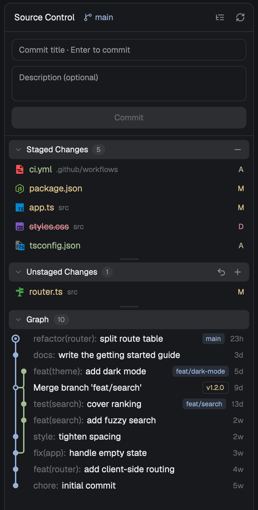
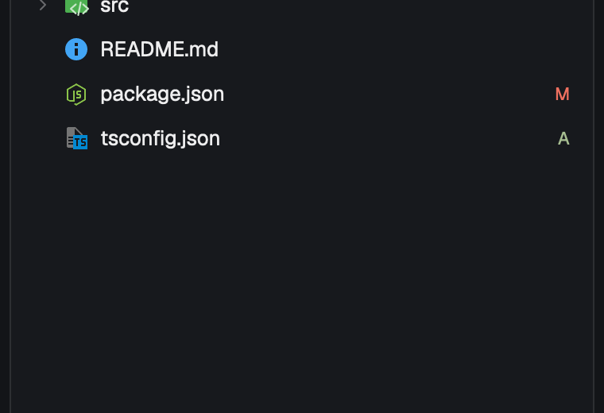

# herdr-mods

Mods for the [Herdr app](https://herdr.dev). Each mod takes its colours from the active theme, so it fits any layout.

Each folder is one mod, in the form that [herdr.dev/mods](https://herdr.dev/mods) lists: `<name>/mods/<name>/` is the mod, `README.md` tells how to install and use it, `RECIPE.md` (when there is one) is the brief an agent can rebuild it from, and `preview.png` shows it.

## Mods

| Mod | What it does | Needs |
|---|---|---|
| [git-panel](git-panel) | Source control panel like VS Code's: staged and unstaged changes with file icons, a commit graph, diffs, stage, discard, commit and a branch switcher | file-icons |
| [file-icons](file-icons) | Files panel with Material Icon Theme icons, and the icon set other mods use | — |

<a href="git-panel"></a> <a href="file-icons"></a>

The screenshots use a made-up repository.

## Install

Run the script. It copies every mod into `~/.config/herdr-app/mods/` and checks each one with `herdr-app check` when that command is available. Set `HERDR_APP_HOME` to use another app home.

```sh
./install.sh
```

The mods are copied, not linked, because Herdr does not load `svg()` icons or hot reload a mod whose folder is a symlink. Each mod's README says which layout block it fits.

## Add a mod

1. Make the folder `<name>/mods/<name>/` with `main.js` and `mod.json`.
2. Add `<name>/README.md`, and a `preview.png` and `RECIPE.md` when you can.
3. Add a row to the table above. If the mod imports another mod, write that mod under "Needs".

`install.sh` finds the new mod with no change. A mod cannot import a file from another mod (`herdr-app check` refuses it), so a mod that needs code from another one keeps its own copy.

## Licence

Apache-2.0 (`LICENSE`), except where a mod folder has its own `LICENSE`. file-icons is MIT, from [cybertron288/herdr-mods](https://github.com/cybertron288/herdr-mods).
