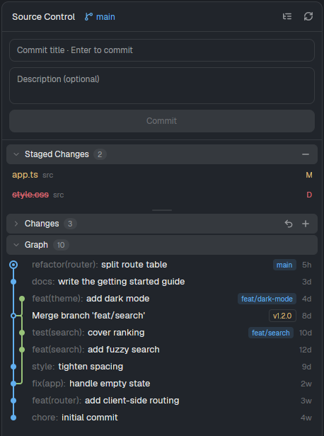

# git-panel

A source control panel for [Herdr](https://herdr.dev), like the one in VS Code: branch, staged and unstaged changes, a commit graph, diffs, stage, discard, commit and a branch switcher.



## Install

git-panel needs the [file-icons](../file-icons) mod for its file icons. Copy both mod folders into your Herdr home, or run `./install.sh` at the root of this repo. Copy them as real folders: Herdr does not load the icons of a mod whose folder is a symlink.

```sh
cp -r mods/git-panel ../file-icons/mods/file-icons ~/.config/herdr-app/mods/
herdr-app check ~/.config/herdr-app/mods/git-panel
```

Then show it in a layout block: `{ "type": "block", "content": { "mod": "git-panel" } }`.

To use it in place of Herdr's Changes panel, clone the shipped layout and point its `changes` block at this mod. Keep the block id `changes`, because the tab bar's Changes button selects it:

```sh
herdr-app do layout.clone '{"name":"main","as":"my-layout"}'
```

In `~/.config/herdr-app/layouts/my-layout.json`, change `"mod": "changes"` to `"mod": "git-panel"`.

## What it does to your repository

It runs git in the repository of the focused terminal. It can stage, unstage, commit, switch and create branches, and discard working-tree changes. Discard asks first, and it deletes untracked files for good. It uses no network.

`RECIPE.md` describes the panel in full, so you can rebuild or change it.

## Licence

Apache-2.0 (`../LICENSE`). The panel started from Herdr's shipped `changes` mod (Apache-2.0). The icons are from [Lucide](https://lucide.dev) (ISC, `mods/git-panel/LICENSE-lucide.txt`). The file icons come from the `file-icons` mod (see its README).
