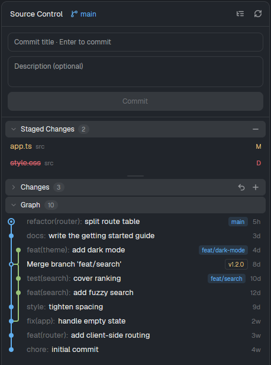

# git-panel

A source control panel for Herdr, like the one in VS Code. It shows the git repository of the terminal you are working in: the branch, the staged and the unstaged changes, a commit graph of all branches, and the diff of the file you select. You can stage, unstage, discard and commit, and you can switch to a branch or create one, without leaving the panel.

## What you see

The panel is one rounded card that fills its block: radius 10px, `theme().background`, 1px `theme().border`, base text 13px in `theme().foreground`. It is designed for a right column of about 368px and works down to 280px. From top to bottom:

- **Header**, 42px, a 1px line under it. "Source Control" in semibold, then the branch: a `git-branch` icon and the name in 12px `theme().accent`, cut with an ellipsis. Small up and down arrows with counts follow when the branch is ahead of or behind its upstream. A detached HEAD shows "Detached HEAD" in `theme().blocked`. At the right edge are two 22px icon buttons: list/tree view and reload.
- **Branch picker**, only while open, under the header. A filter field (30px, accent border) and a list of at most 208px with local branches first (`foreground`), remote branches (`muted`), and the current branch in `accent` with "current" on the right. When the filter names no local branch, the first row is "Create branch <name>".
- **Commit form**, 10px padding, 8px gaps: a 32px title field ("Commit title · Enter to commit"), a description field that grows from 2 to 6 rows ("Description (optional)"), and a full-width 32px button. The button reads "Commit" when something is staged, "Commit all" when nothing is, and "Nothing to commit" on a clean tree. It uses `theme().solid` when enabled and `theme().raised` with `dim` text when not.
- **Staged Changes**, only when something is staged, then **Unstaged Changes**, then **Graph**. Each section has a 28px header on `theme().raised` with a chevron, the title in 12px semibold and a count pill. Staged Changes has an "Unstage all" button. Unstaged Changes has "Discard all" and "Stage all".
- **File rows**, 26px with a 2px gap. A 16px Material Icon Theme icon comes first, from the `file-icons` mod (tree folders get the folder icon, open or closed). The file name is in its status colour: modified in `ansi3` (yellow), added and untracked in `ansi2` (green), deleted and conflicted in `ansi1` (red), and a deleted name is struck through. In list view the folder follows in 11px `dim`. In tree view folders are rows with a chevron, and each level indents 14px. The status letter sits on the right in 11px semibold: M, A, D, U (untracked) or ! (conflict).
- **Grips**, a 6px bar under Staged Changes and under Unstaged Changes with a 28×2px handle in `border` (`accent` while dragging).
- **Graph rows**, 24px with no gap so lanes join. A lane column (12px per lane, narrower past 8 lanes, at most 120px), then the subject, then up to two ref badges and "+n", then a short age ("5h", "3d", "2w") in 11px `dim`. Lanes are 2px lines with rounded corners where branches fork and merge, in the colours `ansi4, ansi2, ansi5, ansi3, ansi6, ansi1` by column. A commit is an 8px dot, a merge an 8px ring, and HEAD a 12px ring with a dot inside. A conventional-commit prefix ("feat(router):") is `dim`, and the rest of the subject is `foreground`. A local branch badge is accent on a tinted fill, while remote and tag badges have a border (tags in `ansi3`). A remote that matches a local branch on the same commit, and `*/HEAD`, are not shown.
- **Diff pane**, when a file is selected, at the bottom: a 28px bar with the file name, its folder in `dim` and a close button, then the diff in the terminal font at 11px. Each line is 20px with its line number, added lines on a green tint and removed lines on a red tint, and hunk headers on `raised`.
- **Bars**, when needed, above the diff: a red-tinted confirmation bar with Cancel and Discard, and a red-tinted error bar with a dismiss button.

## How it behaves

- **Which repository.** The folder of the focused pane, else the focused terminal block, else the active space's folder. A space on another machine reads git there. When the folder or the machine changes, everything resets.
- **Refresh.** Every 10 seconds, and on every change under the repository when it is on this computer. When git's output has not changed, the panel does not rebuild or redraw. An open working-tree diff still reloads, because an edit to an already modified file leaves the status unchanged.
- **Rows.** Click a file to open its diff below, and click it again to close it. Hovering a row fades in its buttons over 120ms: unstage on staged rows, and discard and stage on unstaged rows. Conflicted files have no discard button. A selected row keeps `selected` and does not take the hover colour. Buttons darken while pressed, and each has a tooltip.
- **Discard.** It always asks first in the confirmation bar, and Escape cancels. It only touches the working tree: `git restore` for changed files and `git clean -f` on the listed untracked files. Staged changes and conflicts are never touched.
- **Commit.** Enter in the title, or the button. The description becomes a second paragraph of the message. With nothing staged, it stages everything first. The form clears only after the commit succeeds.
- **Branches.** Click the branch name to open the picker, and click it again or press Escape to close it. Type to filter. Click a branch, or press Enter on an exact name, to switch. A remote branch is switched to with `--track`, so it gets a local branch. Enter on a new name creates the branch. If git refuses (uncommitted changes would be lost), its message shows in the error bar.
- **Graph.** Click a commit to open it: a line with hash, author and date, then its files, with the lanes running beside them. Click a file to see its diff in that commit. The graph covers the last 100 commits of all branches, remotes and tags.
- **Sections.** Click a header to fold it. Drag a grip to make Staged Changes or Unstaged Changes taller or shorter. A section is never taller than its rows, and the Graph keeps at least 120px. Heights are remembered.
- **Scroll.** Each section scrolls on its own. While the wheel moves, hover changes do not redraw the panel.
- **Agent status.** The panel shows no agent status. It is about the repository only.
- **Keys.** Enter commits from the title and submits the branch filter. Escape closes the picker or the confirmation, else leaves the text fields. There are no global keys.

## Built from

- `mods/git-panel/`: `main.js`, `mod.json` (`{ "place": "none" }`) and the SVG icons (Lucide, ISC, licence in `LICENSE-lucide.txt`). No props.
- `icon()` from `lookup.js`, a copy of the `file-icons` lookup with its `icons.js` (a mod cannot import from another mod). The SVGs load from `mods/file-icons/icons/`, so `file-icons` must be installed beside it.
- Layout: put it in any block, `{ "type": "block", "content": { "mod": "git-panel" } }`. To replace Herdr's Changes panel, clone the `main` layout and set the content of the block with id `changes` (inside the `panel-body` stack) to `git-panel`. Keep the id, because the tab bar's Changes button selects it.
- `gpui-kit`: `View`, `div`, `svg`, `image`. `gpui-base`: `v_flex`, `h_flex`, `InputState`, `Input`, `TextareaState`, `Textarea`, `Scrollbar`, `v_virtual_list`.
- `herdr`: `spaces`, `panes`, `focused` (which folder and machine), `exec` (git), `readTextFile` (untracked files as a diff), `watchFolder`, `theme`, `settings` (`font_family` for the diff). It runs no app commands.
- Git reads, all with `--no-optional-locks -c core.fsmonitor=false -c diff.autoRefreshIndex=false`:
  - `rev-parse --show-toplevel`, once per folder;
  - `status --porcelain=v1 --branch -z --untracked-files=all` and `log --topo-order --decorate=full -n 100 --branches --remotes --tags HEAD --format=%H%x1f%P%x1f%h%x1f%an%x1f%ar%x1f%D%x1f%s`, in parallel on each refresh;
  - `diff`, `diff --cached` and `show --format= <hash>` with `--no-ext-diff --no-textconv --no-color -- <path>`;
  - `diff-tree -r --root --no-commit-id --name-status --no-renames -z <hash>`;
  - `for-each-ref --format=%(refname) refs/heads refs/remotes`.
- Git writes: `add -- <path>`, `add -A`, `restore --staged -- <path>` (`rm --cached` before the first commit), `restore -- <paths>`, `clean -f -- <paths>`, `commit -m <title> [-m <body>]`, `switch <name>`, `switch --track <remote>/<name>`, `switch -c <name>`.
- The graph does not use git's ASCII art. `layoutGraph()` gives lanes from each commit's parent hashes, and `graphCell()` draws one row of absolute 2px lines, bordered corners and the dot.

## Watch out

- **It runs git and changes the repository.** It stages, unstages, commits, switches branches, and discards working-tree changes, which deletes untracked files for good. It reads files in the repository for diffs. It uses no network.
- **Install the mod as a real folder, not a symlink.** Herdr does not load `svg()` icons, or hot reload a mod, whose folder is a symlink.
- **A scroll area whose height comes only from flex-grow renders at zero height.** Every section gets an explicit height: the lists from their rows (28px each) up to their cap, and the Graph from what the column has left, measured with `on_size_change` on the list column.
- **Virtual-list rows take no handlers.** The Graph is a `v_virtual_list` so a long history scrolls cheaply. Clicks go through one `on_item_click` that reads the item from its key. Tooltips are not used there. Staged Changes and Changes stay plain lists because their rows have buttons.
- **There is no group hover.** The hovered row id is kept in the view. That costs a redraw per row entered, which is why hover redraws are skipped while scrolling.
- **Reads must not write under `.git`.** Otherwise the folder watch triggers a refresh, which writes again.
- **Limits.** 1,000 changed files, 100 commits, 200 branches in the picker, 1,500 diff lines, lines cut at 4,000 characters, and untracked files read up to 400,000 characters. Commit files under the Graph are always a flat list. There is no push, pull or fetch, and no hunk staging.
- **A name that starts with "-" is refused** when creating a branch, so git cannot read it as an option.

## Done when

1. `herdr-app check mods/git-panel` passes.
2. In a repository with staged, modified, deleted and untracked files, the panel lists each in the right section with the right colour and letter, the deleted name struck through.
3. Hovering a row shows its buttons. Stage, unstage and stage all move files between sections.
4. Discard asks first. After confirming, a modified file returns to its staged version and an untracked file is gone, while staged changes stay.
5. A title commits with Enter. With a description, `git log -1 --format=%B` shows both paragraphs.
6. The Graph shows a merged branch as a lane that forks and joins with rounded corners, HEAD as a ring with a dot, a merge as a ring, a tag badge, and ages on the right.
7. Clicking a commit shows its files beside the lanes, and clicking one shows its diff.
8. The branch picker switches to a local branch, creates a tracking branch from a remote one, and creates a new branch from the filter.
9. Dragging the grip under Staged Changes makes it taller up to its rows, the Graph never drops below 120px, and the height survives a reload.
10. Each section scrolls on its own, and a folder outside a repository shows "No repository here".
